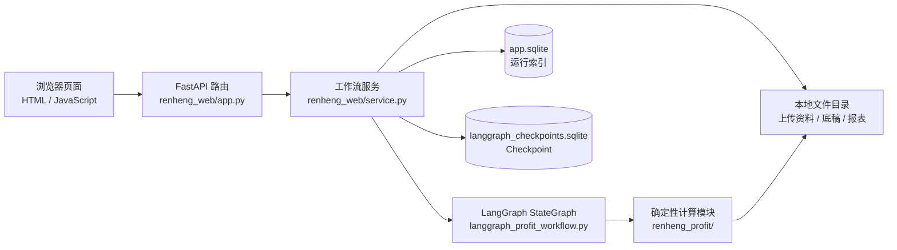

# 六主体合并利润表工作流系统

这是一个面向特定合并利润表流程的本地财务工作台。财务人员通过网页上传资料并选择期间，系统执行预检、生成 M1–M7 底稿、校验销售台账；出现非零差异时暂停等待财务填写确认收入，恢复后重新校验，四组差异全部归零才会生成正式 `.xls` 报表。

## 功能

- 通过本地网页创建任务、上传或补充 Excel 资料、预检资料、启动计算和查询任务状态。
- 使用 LangGraph StateGraph 编排工作流，分别执行本年和去年同期计算分支。
- 生成 M1–M7 过程底稿，并保存结构化的 `run_status.json`。
- M7 对本年/去年同期、本月/累计四组收入进行校验；存在差异时生成审核材料并暂停，财务修正后从同一 `thread_id` 恢复。
- 仅在四组差异全部归零后生成正式 `.xls` 报表。

## 技术栈

Python 3.10+、LangGraph、FastAPI、SQLite、Pydantic、openpyxl、xlrd、xlutils、xlwt、HTML/JavaScript。

Excel 处理由上述 Excel 库和 Python 代码完成；当前实现没有使用 Pandas。运行记录及 LangGraph Checkpoint 使用 SQLite，原始文件和输出文件保存在本地目录；当前实现没有接入 PostgreSQL 或 MinIO。

## 架构



`run_id` 是网页端的业务任务编号；`thread_id` 是 LangGraph Checkpoint 使用的运行标识。网页运行索引和工作流 Checkpoint 分别保存在两个 SQLite 文件中。

## 运行环境

- Windows 10/11
- Python 3.10 或更高版本
- 可访问项目依赖包源以安装 `requirements.txt` 中的依赖

## 安装与启动

在 PowerShell 中进入项目根目录：

```powershell
cd "C:\path\to\renheng-consolidated-profit"
python --version
python -m venv .venv
.\.venv\Scripts\Activate.ps1
python -m pip install -r requirements.txt
```

启动本地网页工作台：

```powershell
python scripts\run_local_web_app.py --data-root .\data
```

然后在浏览器打开：

```text
http://127.0.0.1:8000
```

启动参数还支持 `--host` 和 `--port`。默认仅监听本机地址 `127.0.0.1:8000`。当前版本的主要使用入口是网页；仓库中没有独立的命令行运行入口脚本。

## 使用流程

1. 在网页选择年度、月份并填写经办人，上传本次任务的资料。
2. 页面执行资料预检；缺件时可在任务启动前补充或替换资料，再重新预检。
3. 预检通过后启动计算。系统创建唯一的 `run_id` 和 `thread_id`，并将任务加入单机串行执行队列。
4. M7 四组差异均为零时，工作流生成正式报表。
5. 出现差异时，工作流暂停并生成差异审核材料。财务人员填写正确营业收入、审核人和原因后提交，系统使用原 `thread_id` 恢复并重新执行下游计算和校验。
6. 可在任务页面查询状态并下载已生成的审核材料、底稿和正式报表。

## API

网页与后端之间通过以下 HTTP API 通信：

| 方法 | 路径 | 用途 |
|---|---|---|
| `GET` | `/api/runs` | 查询任务列表 |
| `POST` | `/api/runs` | 创建任务并上传初始资料 |
| `GET` | `/api/runs/{run_id}` | 查询任务状态、预检结果和产物 |
| `POST` | `/api/runs/{run_id}/files` | 启动前补充或替换资料 |
| `POST` | `/api/runs/{run_id}/preflight` | 执行资料预检 |
| `POST` | `/api/runs/{run_id}/start` | 启动工作流 |
| `POST` | `/api/runs/{run_id}/resume` | 提交财务修正并恢复工作流 |
| `GET` | `/api/runs/{run_id}/artifacts/{key}` | 下载指定产物 |

接口路由定义在 `scripts/renheng_web/app.py`，页面调用代码位于 `scripts/renheng_web/web/index.html`。

## 目录结构

```text
.
├─ .gitignore
├─ README.md
├─ requirements.txt
├─ references/
│  └─ BUSINESS_RULES.md              # 工作流使用的业务规则
├─ scripts/
│  ├─ run_local_web_app.py           # 网页启动入口
│  ├─ langgraph_profit_workflow.py   # StateGraph、节点、分支与中断恢复
│  ├─ renheng_web/
│  │  ├─ app.py                      # FastAPI 路由
│  │  ├─ service.py                  # Web 请求到工作流的服务层
│  │  ├─ database.py                 # SQLite 运行记录仓储
│  │  └─ web/index.html              # 操作页面
│  └─ renheng_profit/
│     ├─ common.py                   # 公共数据结构与金额/期间工具
│     ├─ runtime.py                  # 输入指纹与运行状态文件
│     ├─ income_statements.py        # 利润表解析和汇总
│     ├─ invoices.py                 # 开票收入和内部销售处理
│     ├─ consolidation.py            # 合并计算、指标和报表模板回填
│     └─ ledger_validation.py        # 销售台账与 M7 校验
└─ tests/                            # unittest 测试
```

## 数据与产物

默认数据根目录是启动命令中的 `data`：

```text
data/
├─ app.sqlite                          # 网页运行记录索引
├─ langgraph_checkpoints.sqlite        # LangGraph 工作流 Checkpoint
└─ runs/{run_id}/
   ├─ input/                           # 本次上传的原始资料
   ├─ output/                          # 本次计算产物
   ├─ metadata.json
   └─ upload_manifest.json
```

每次工作流的底稿目录位于：

```text
data/runs/{run_id}/output/consolidated_profit_{year}_{month}/{thread_id}/
```

底稿按以下目录分类保存：

```text
M1_资料及期间确认/
M2_单体数据及研发拆分/
M3_抵销前六主体汇总/
M4_内部销售/
M5_抵销后合并结果/
M6_指标及模板回填/
M7_销售台账校验/
run_status.json
```

## 测试

在项目根目录、激活虚拟环境后运行：

```powershell
python -m unittest discover -s tests -v
```

## 文档

- [网页工作台启动说明](scripts/WEB_APP.md)
- [业务规则说明](references/BUSINESS_RULES.md)
- [代码逐行技术讲解](代码逐行技术讲解.md)

## 使用范围与公开前检查

当前网页服务面向本机或受控环境中的少量使用者；代码没有实现登录、角色权限或多租户隔离，不应直接暴露到公网。上传内容包含财务数据，应按组织的数据管理要求存储和备份。

本项目包含特定业务规则和报表处理逻辑。公开到个人 GitHub 前，请确认已获授权，并检查业务规则、模板、真实 Excel、数据库、Checkpoint、输出报表和本机配置是否需要删除或脱敏。不要将 `.venv`、`scripts/.venv`、`data` 或 `outputs` 等本地环境和运行数据提交到仓库。
