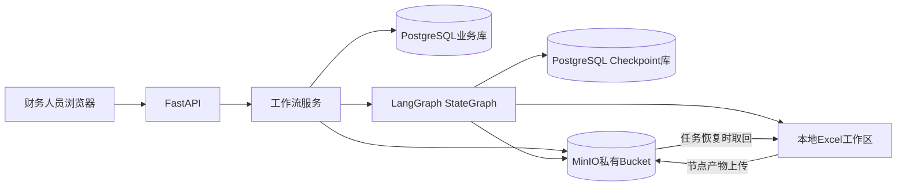

# 仁恒六主体合并利润表工作流

本项目提供 FastAPI 网页工作台和 LangGraph 工作流，用于上传合并资料、执行 M1–M7 底稿计算、处理销售台账差异，并在四组收入差异归零后发布正式 `.xls` 报表。

## 架构



- **业务 PostgreSQL 数据库**：`users`、`workflow_runs`、`workflow_files`、`approval_records` 和 `run_events` 表。`run_id` 映射到唯一 `thread_id`；文件表保存 MinIO 对象键、名称、SHA-256、大小、版本及本地工作区相对路径。
- **Checkpoint PostgreSQL 数据库**：由 LangGraph 的 `PostgresSaver` 管理工作流状态。工作流 State 只保存文件引用和计算状态，不保存 Excel 文件字节或明细表。
- **MinIO**：保存上传文件、M1–M7 产物、差异审核文件、修正记录和正式报表。应用通过私有 bucket 的对象键访问文件。
- **本地工作区**：计算模块继续使用文件路径处理 Excel。工作区位于 `--data-root` 下，服务恢复任务时会依据 PostgreSQL 文件索引从 MinIO 校验和重建文件。MinIO 是持久文件存储。
- **财务计算**：保留 `scripts/renheng_profit/` 中的确定性计算函数；不依赖大模型生成金额。

LangGraph 的 PostgreSQL Checkpoint 需要在首次使用时创建其内部表；本应用通过 `PostgresSaver.setup()` 执行该初始化。[LangGraph Checkpoint Postgres 文档](https://github.com/langchain-ai/langgraph/blob/main/libs/checkpoint-postgres/README.md)

## 本地启动

需要 Python 3.10+ 和 Docker Desktop。

1. 在项目根目录创建本机配置：

   ```powershell
   Copy-Item .env.example .env
   ```


2. 启动 PostgreSQL 和 MinIO：

   ```powershell
   docker compose up -d
   ```

   PostgreSQL 使用 `profit_business` 和 `profit_checkpoint` 两个数据库；MinIO 控制台默认在 `http://127.0.0.1:9001`。

3. 安装 Python 依赖并创建业务数据库表：

   ```powershell
   python -m venv .venv
   .\.venv\Scripts\Activate.ps1
   python -m pip install -r requirements.txt
   python scripts\run_db_migrations.py
   ```

4. 创建用户。首次先创建管理员，再创建财务和审核人员：

   ```powershell
   python scripts\create_user.py admin 管理员 --role ADMIN
   python scripts\create_user.py finance1 财务人员 --role FINANCE
   python scripts\create_user.py reviewer1 审核人员 --role REVIEWER
   ```

   命令会交互式提示输入密码；密码至少 12 位，数据库只保存 PBKDF2 哈希。

5. 启动网页：

   ```powershell
   python scripts\run_local_web_app.py --data-root .\data
   ```


## 任务流程

1. 财务人员登录后选择年度、月份并上传资料。
2. 原文件上传 MinIO，文件版本、哈希和对象键登记到 PostgreSQL；服务将文件取回本地工作区执行预检。
3. 预检通过后，LangGraph 使用 PostgreSQL Checkpoint 执行本年和去年同期分支及 M1–M7 节点。每个节点完成后先将产物上传 MinIO，再把 MinIO 对象引用写入 State。
4. 若 M7 有差异，工作流暂停为 `WAITING_REVIEW`。审核人员提交修正原因和正确营业收入；审批修正记录与任务入队状态在同一 PostgreSQL 事务中保存。
5. 后端用原 `run_id` 查出同一 `thread_id`，恢复 Checkpoint 并重算下游节点。服务重启后会重新入队 `QUEUED`、`RUNNING` 任务；等待财务审核的任务保持暂停。
6. 仅四组差异归零后才生成并上传正式报表。

FINANCE 用户可以创建、补资料和启动任务；REVIEWER 或 ADMIN 用户可以提交财务修正。审核记录用于追溯修正人、原因、轮次和修正值，不提供“带差异发布”通道。

## API

| 方法 | 路径 | 用途 |
|---|---|---|
| `POST` | `/api/auth/login` | 登录并设置 HttpOnly 会话 Cookie |
| `POST` | `/api/auth/logout` | 退出登录 |
| `GET` | `/api/auth/me` | 查询当前用户 |
| `GET` | `/api/runs` | 查询任务列表 |
| `POST` | `/api/runs` | 创建任务并上传资料 |
| `GET` | `/api/runs/{run_id}` | 查询任务、产物和审核记录 |
| `POST` | `/api/runs/{run_id}/files` | 补充或替换启动前资料 |
| `POST` | `/api/runs/{run_id}/preflight` | 预检资料 |
| `POST` | `/api/runs/{run_id}/start` | 启动工作流 |
| `POST` | `/api/runs/{run_id}/resume` | 提交财务修正并恢复 |
| `GET` | `/api/runs/{run_id}/artifacts/{key}` | 鉴权后从 MinIO 流式下载产物 |

## 数据迁移与运行要求

- 本版本不自动导入旧 `app.sqlite`、SQLite Checkpoint 或旧目录下的 Excel。切换前应完成旧的暂停任务；旧 Checkpoint 迁移需单独验证。
- PostgreSQL、MinIO 和本地工作区都包含财务敏感信息，应设置访问权限、备份和保留策略。生产部署时应为应用创建权限受限的 MinIO 用户，不使用 MinIO root 账号。
- PostgreSQL 和 MinIO 的写入不属于同一事务。上传失败会记录任务失败状态；重复上传采用新的文件版本；无效对象可按对象前缀定期清理。
- Checkpoint 只在 `CHECKPOINT_DATABASE_URL` 配置的独立数据库内由 LangGraph 管理；不要在应用业务表中手动修改 LangGraph 内部表。

## 测试

```powershell
python -m unittest discover -s tests -v
